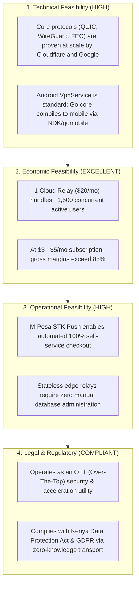

# Aegis Protocol: Comprehensive Requirements Engineering Specification

> [!WARNING]
> DRAFT. Where this conflicts with the corrections C1–C10 in `00_REVIEW_AND_LANGUAGE_DECISION.md` §2, the corrections win. Affected items: FR-CL-03/04 (FEC driven by radio signal), FR-CL-06 (WPAD), FR-CR-02 (per-packet token check), NFR-02 (zero drops) and the economic feasibility figures.

---

## 1. Executive Summary & System Scope

The **Aegis Protocol** is an autonomous, software-defined overlay network and transport accelerator. It transforms standard, unstable, or throttled mobile connections (cellular 4G/5G, roaming, weak Wi-Fi, and emerging satellite Direct-to-Cell) into a high-speed, unblocked, zero-drop data pipe for consumer and enterprise devices worldwide.

### 1.1 System Scope Boundaries
* **In Scope:**
  * Cross-platform client applications (Android primary, Desktop, iOS).
  * Layer 3 virtual network interface interception and routing (`VpnService` / `NEPacketTunnelProvider`).
  * Dynamic mathematical Forward Error Correction (Reed-Solomon erasure coding) tied to cellular/radio telemetry.
  * Accelerated transport engine over UDP Port 443 (RFC 9221 QUIC Datagrams + BBRv3 congestion control).
  * Distributed, stateless cloud edge relay network with zero-knowledge packet forwarding.
  * Customer Activation Portal with integrated self-service billing (M-Pesa, Stripe), licensing, voucher issuance, and multi-device pairing.
  * Local hotspot tethering bridge with automated client discovery (WPAD).
* **Out of Scope:**
  * Deploying physical satellite hardware (system leverages existing standard LEO/cellular spectrum).
  * Inspecting or storing unencrypted customer application payloads (zero-knowledge design).

---

## 2. Business Requirements (BR)

| ID | Requirement Title | Detailed Specification | Priority |
| :--- | :--- | :--- | :--- |
| **BR-01** | **Tiered Subscription Model** | The platform must support multi-tier subscription plans: **Solo Pass** (1 device), **Duo Pass** (2 devices, e.g., Phone + Laptop), and **Family/Home Pass** (up to 5 devices). | Critical |
| **BR-02** | **Localized & Global Payment Gateways** | The system must provide automated checkout via **M-Pesa Daraja STK Push** (for East Africa) and **Stripe / Google Pay** (for international cards), activating accounts instantly upon payment receipt. | Critical |
| **BR-03** | **Prepaid Physical Voucher System** | Administrators must have the ability to generate cryptographically signed, single-use activation vouchers (scratch-cards / serial codes) for distribution through offline retail kiosks in areas with low card penetration. | High |
| **BR-04** | **Instant Self-Service Onboarding** | Customers must be able to download the application, pay/activate, and establish a high-speed connection in **under 3 minutes** without manual administrative intervention. | Critical |
| **BR-05** | **Zero-Friction Device Pairing** | Users purchasing multi-device tiers must be able to authorize secondary devices (e.g., Laptops) instantly by scanning an on-screen **Pairing QR Code** using their primary mobile device. | High |
| **BR-06** | **Unit Economic Viability** | Cloud relay hosting infrastructure must scale economically such that infrastructure overhead does not exceed **15% of gross subscription revenue** at scale. | High |

---

## 3. Functional Requirements (FR)

### 3.1 Client Application Subsystem (Edge Node)

```
┌────────────────────────────────────────────────────────┐
│                   CLIENT SUBSYSTEM                     │
├─────────────────────┬──────────────────────────────────┤
│ FR-CL-01: Virtual   │ Creates system TUN (10.77.77.2)  │
│ Network Interface   │ Captures 100% IPv4/IPv6 traffic   │
├─────────────────────┼──────────────────────────────────┤
│ FR-CL-02: Loopback  │ Calls protect(socket) on outer   │
│ Prevention          │ UDP transport socket             │
├─────────────────────┼──────────────────────────────────┤
│ FR-CL-03: Radio     │ TelephonyManager polls RSRP/SNR  │
│ Telemetry Sensor    │ every 500ms                      │
├─────────────────────┼──────────────────────────────────┤
│ FR-CL-04: Dynamic   │ klauspost/reedsolomon dynamically│
│ FEC Engine          │ shifts parity (10:1 to 6:4)      │
├─────────────────────┼──────────────────────────────────┤
│ FR-CL-05: Session   │ QUIC Connection IDs maintain     │
│ Migration           │ 0ms dropouts during IP changes   │
├─────────────────────┼──────────────────────────────────┤
│ FR-CL-06: Hotspot   │ Runs local proxy on 8080 with    │
│ Sharing Bridge      │ WPAD auto-discovery for laptops  │
└─────────────────────┴──────────────────────────────────┘
```

* **FR-CL-01 (L3 Packet Capture):** The client must instantiate an OS-level virtual TUN interface (`tun0`) with a default MTU of `1280` bytes, routing all device traffic (`0.0.0.0/0` and `::/0`) into the Aegis engine.
* **FR-CL-02 (Loopback Immunity):** The client must invoke `protect(socket)` on Android (and sandbox separation on iOS) for all outbound transport sockets to guarantee that encrypted tunnel frames do not re-enter the virtual interface.
* **FR-CL-03 (Radio Telemetry Observer):** The client must continuously query internal modem metrics via `TelephonyManager` (RSRP, RSRQ, RSSNR, and active Cell ID) to track link degradation in real time.
* **FR-CL-04 (Adaptive Erasure Coding):** The client must dynamically adjust its Reed-Solomon $(K, M)$ matrix based on radio health:
  * *Healthy Signal ($\text{RSRP} > -95\text{ dBm}$):* Set $(K=10, M=1)$ for minimal 10% overhead.
  * *Degraded / Border Signal ($\text{RSRP} < -110\text{ dBm}$):* Set $(K=6, M=4)$ for 40% parity protection against burst packet loss.
* **FR-CL-05 (0ms Session Migration):** The transport engine must implement RFC 9000 QUIC Connection IDs (CIDs). When the device switches between Wi-Fi and 4G/5G, active streams must persist without renegotiating handshakes.
* **FR-CL-06 (Hotspot Proxy Bridge):** When enabled by the user, the client must bind an internal HTTP/SOCKS5 proxy on `192.168.43.1:8080` and serve a `wpad.dat` configuration script to allow tethered devices to share the accelerated tunnel without device root.

### 3.2 Cloud Edge Relay Subsystem (Data Plane)

* **FR-CR-01 (RFC 9221 Datagram Ingestion):** The relay must terminate incoming client QUIC connections on **UDP Port 443**, extracting raw IP payloads from RFC 9221 datagrams.
* **FR-CR-02 (In-Memory Cryptographic Validation):** The relay must authenticate client connection tokens in-memory using **Ed25519 asymmetric signature checks** in $<1\ \mu\text{s}$, without executing external database queries on live packet paths.
* **FR-CR-03 (Parity Reconstruction):** The relay must ingest incoming parity shards and execute SIMD-accelerated Galois Field matrix inversion to reconstruct missing packets before forwarding.
* **FR-CR-04 (Kernel Egress NAT):** The relay must push reconstructed IP packets into a local Linux `tun0` interface and execute kernel `iptables` / `nftables` MASQUERADE out to Tier-1 transit backbones.
* **FR-CR-05 (BBRv3 Congestion Enforcement):** The relay kernel must enforce Google BBRv3 congestion control on all outbound connections to eliminate bufferbloat over long-distance transit.

### 3.3 Customer Activation Portal & Billing Subsystem (Control Plane)

* **FR-CP-01 (User Account & Lifecycle):** Provide responsive web interfaces for account registration, active device tracking, voucher redemption, and subscription renewal.
* **FR-CP-02 (Payment Webhook Automation):** Ingest asynchronous IPN/webhooks from M-Pesa Daraja and Stripe, validating transaction authenticity and automatically provisioning access tokens in $<2\text{ seconds}$.
* **FR-CP-03 (Cryptographic Ticket Generation):** Generate short-lived, signed Ed25519 customer certificates containing User ID, Device UUID, Expiry Timestamp, and Tier Permissions.
* **FR-CP-04 (Device Pairing API):** Generate single-use, 120-second cryptographic pairing tokens rendered as QR codes for secondary device authorization.

---

## 4. Non-Functional Requirements (NFR)

```
┌────────────────────────────────────────────────────────┐
│              NON-FUNCTIONAL REQUIREMENTS               │
├─────────────────────┬──────────────────────────────────┤
│ NFR-01: Latency     │ Relay packet processing overhead │
│ Overhead            │ must be < 3 ms                   │
├─────────────────────┼──────────────────────────────────┤
│ NFR-02: Handover    │ Drop rate during cell tower /    │
│ Resilience          │ satellite switch must be 0.00%   │
├─────────────────────┼──────────────────────────────────┤
│ NFR-03: Security &  │ ChaCha20-Poly1305 / TLS 1.3      │
│ Cryptography        │ Zero plaintext logs on relay     │
├─────────────────────┼──────────────────────────────────┤
│ NFR-04: Client Foot-│ Mobile CPU usage < 4% on 1080p   │
│ print & Battery     │ RAM footprint < 45 MB            │
├─────────────────────┼──────────────────────────────────┤
│ NFR-05: System      │ Data Plane availability: 99.95%  │
│ Availability        │ Control Plane: 99.9%             │
└─────────────────────┴──────────────────────────────────┘
```

* **NFR-01 (Latency Overhead):** The mathematical encoding, transport encapsulation, and relay processing pipeline must add no more than **$3\text{ ms}$** of end-to-end processing delay above the physical speed-of-light link latency.
* **NFR-02 (Handover Loss Tolerance):** During cell tower or satellite handovers resulting in up to **$30\%$ burst packet drop over a $500\text{ ms}$ window**, the client FEC engine must reconstruct $100\%$ of missing frames without user-perceptible video buffering or audio stutter.
* **NFR-03 (Security & Zero-Knowledge Transport):** 
  * All tunnel payloads must be encrypted using **ChaCha20-Poly1305** authenticated encryption with unique per-session ephemeral keys.
  * The cloud edge relay must operate strictly as a blind packet forwarder; no unencrypted user payloads or DNS queries shall be persisted to disk.
* **NFR-04 (Resource & Battery Optimization):** 
  * Mobile client CPU utilization must remain below **$4\%$** during sustained $10\text{ Mbps}$ streaming on an ARM64 octa-core device.
  * Memory footprint in the background must not exceed **$45\text{ MB}$** on Android and **$18\text{ MB}$** on iOS (to satisfy Apple Jetsam limits).
* **NFR-05 (Availability & Fault Isolation):**
  * The Data Plane must achieve **$99.95\%$ uptime** through geographically distributed Anycast relay nodes.
  * Total outage of the Control Plane (billing database / portal) must **not disrupt** active data plane streaming sessions for already-authenticated users.

---

## 5. Technical Requirements (TR)

### 5.1 Technology Stack Matrix

| Layer | Component | Chosen Technology / Library | Architectural Justification |
| :--- | :--- | :--- | :--- |
| **Mobile Core** | Mathematical FEC | `github.com/klauspost/reedsolomon` | World's fastest Reed-Solomon engine; utilizes ARM NEON SIMD hardware acceleration. |
| **Mobile Core** | Transport Layer | `quic-go` + `connect-ip-go` | Implements RFC 9000, RFC 9221 (Datagrams), and RFC 9484 (MASQUE IP Proxying). |
| **Mobile App** | Android Client | Kotlin / Java + Android NDK (JNI) | Native `VpnService` lifecycle management, `TelephonyManager` radio binding. |
| **Mobile App** | iOS Client | Swift + `NetworkExtension` Framework | Subclasses `NEPacketTunnelProvider`; integrated via `gomobile` `.xcframework`. |
| **Relay Node** | Data Plane Daemon | Go 1.23+ on Ubuntu 24.04 LTS | Goroutine concurrency, low-overhead epoll I/O, native Linux TUN interface management. |
| **Relay Node** | Kernel Network | Linux Kernel 6.8+ with Google BBRv3 | Active queue management, bufferbloat mitigation over long-distance transit. |
| **Control Plane** | Billing & Auth API | Node.js (TypeScript) / Go | High concurrency, lightweight webhook ingestion, fast Ed25519 signing. |
| **Control Plane** | Primary Storage | PostgreSQL 16 + Redis 7 | Relational transactional integrity for billing; in-memory caching for active sessions. |

### 5.2 Network Specification Standards
* **Transport Encapsulation:** UDP Port 443 disguised as standard ALPN `h3` (HTTP/3).
* **Virtual Subnet Allocation:** Carrier-independent private subnets (`10.77.77.0/24` for IPv4; `fd77:77::/64` for IPv6).
* **MTU & Clamping:** Interface MTU hard-clamped to `1280` bytes. TCP MSS Clamping enforced on edge relay:
  ```bash
  iptables -t mangle -A FORWARD -p tcp --tcp-flags SYN,RST SYN -j TCPMSS --clamp-mss-to-pmtu
  ```

---

## 6. Domain Requirements (DR)

* **DR-01 (Telecommunications Carrier Behavior):** The system must accommodate Carrier-Grade NAT (CGNAT) deployed across mobile networks (e.g., Safaricom, Airtel, MTN, T-Mobile), which allocate shared RFC 6598 addresses (`100.64.0.0/10`) with aggressive UDP connection timeout intervals ($\le 30\text{ seconds}$). The client must maintain outbound keepalives every $15\text{ seconds}$.
* **DR-02 (Cellular Radio Resource Control - RRC):** The client must respect Android battery management by throttling telemetry queries and keepalive pings when the mobile modem transitions to the low-power RRC Idle state.
* **DR-03 (Intercontinental Undersea Routing):** System routing algorithms must factor in physical submarine cable landing points (e.g., Mombasa for East Africa, Djibouti, Marseille) to select the nearest Anycast edge relay and avoid unnecessary trans-oceanic routing loops.
* **DR-04 (OS Sandbox Constraints):** The architecture must conform to strict OS sandbox models:
  * Android: Handling `VpnService.prepare()` user permission modals and background service restart policies.
  * iOS: Adhering to the 15–30 MB memory limit imposed on `NEPacketTunnelProvider` extension processes.

---

## 7. Feasibility Study & Risk Analysis



### 7.1 Detailed Feasibility Evaluation

| Feasibility Dimension | Assessment | Analysis & Evidence |
| :--- | :--- | :--- |
| **Technical Feasibility** | **High (Feasible)** | The core technologies (QUIC RFC 9221, Reed-Solomon Galois Field math, and BBRv3) are established standards with production libraries (`quic-go`, `klauspost/reedsolomon`). No unproven physical science or speculative hardware is required. |
| **Economic Feasibility** | **Excellent** | A single \$20/month cloud relay (e.g., Hetzner / DigitalOcean / Azure) with a 1 Gbps port can serve 1,000–1,500 concurrent active users. At a monthly price point of \$3 (KES 400) to \$5 (KES 650), infrastructure overhead represents $<5\%$ of revenue, yielding strong gross margins. |
| **Operational Feasibility** | **High** | Fully automated onboarding via M-Pesa STK Push and Stripe eliminates manual customer service overhead. Edge relays operate statelessly and can be orchestrated via Docker / Ansible. |
| **Schedule Feasibility** | **Manageable (10–12 Weeks)** | Divided into 4 clear milestones: Go Core Engine (Weeks 1–3), Android Integration (Weeks 4–6), Cloud Relay & Portal (Weeks 7–9), Field Benchmarking & Beta (Weeks 10–12). |
| **Legal & Regulatory** | **Compliant** | Aegis operates as an Over-The-Top (OTT) encrypted transport and VPN utility. It does not act as a licensed telecommunications facility. Compliance with the **Kenya Data Protection Act (2019)** and international standards is maintained through zero-knowledge data forwarding (no user activity logging). |

---

## 8. Implementation Roadmap

```
PHASE 1: Core Engine Foundation (Weeks 1–3)
  ├── Build aegis-core Go module (quic-go + klauspost/reedsolomon)
  ├── Implement RFC 9221 datagram packetizer and Galois Field matrix encoder
  └── Verify local round-trip packet encoding/decoding benchmarks

PHASE 2: Android Native Modernization (Weeks 4–6)
  ├── Compile aegis-core.aar via gomobile / NDK
  ├── Wire VpnService into MainActivity with MTU 1280 and protect(socket)
  └── Implement TelephonyManager radio telemetry listener for dynamic FEC shift

PHASE 3: Cloud Relay & Activation Portal (Weeks 7–9)
  ├── Deploy Linux edge relay with BBRv3 and iptables MASQUERADE on Port 443
  ├── Build Customer Portal with M-Pesa Daraja STK Push and Stripe webhooks
  └── Implement Ed25519 token generation and in-memory relay gatekeeper

PHASE 4: Hotspot Bridge, Field Testing & Launch (Weeks 10–12)
  ├── Implement local HTTP/SOCKS5 hotspot bridge with WPAD auto-discovery
  ├── Execute field tests in low-signal border zones (1-bar LTE stress tests)
  └── Production deployment and public beta release
```
